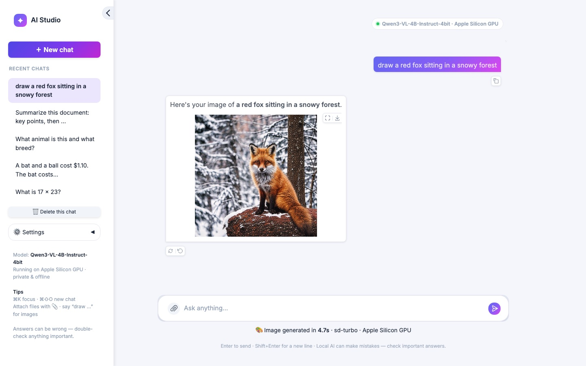

# AI Studio

A private, ChatGPT-style assistant in **one chat window**, running entirely on a Mac (Apple Silicon, 8 GB RAM is enough).
Ask questions, solve maths and logic problems, write and debug code, attach PDFs / Word / text / code files to summarise,
translate or question them, attach photos to ask about them, or say **"draw …"** to generate an image.

| Chat | Image generation in the same chat | Phone |
|---|---|---|
|  |  |  |

## Features
- **One chat for everything.** `models/assistant.py` routes each message: "draw / generate an image of …" → sd-turbo;
  attached photos → the vision-language model; attached documents → inlined as context; everything else → chat.
- **Fast local model.** [Qwen3-VL-4B-Instruct](https://huggingface.co/mlx-community/Qwen3-VL-4B-Instruct-4bit) (4-bit) on Apple's
  MLX: first word in ~0.3–2 s, ~34 tokens/s on an M2. Follow-up turns reuse the KV cache, so only new tokens are processed.
- **Chosen by measurement, not guesswork** — see *Chat model selection* below.
- **ChatGPT-like UX.** Streaming answers, Stop, Retry, Undo (edit & resend), copy buttons, Markdown/code/LaTeX rendering,
  suggestion cards, saved chat history in the sidebar (browser localStorage), light/dark themes, phone layout.
- **Memory-safe.** Only one heavy model is resident at a time (chat model ↔ image model swap on demand), and an idle keep-alive stops macOS from swapping the chat model out (measured: first reply after memory pressure 11.8 s → 3.2 s).
- **Safe defaults.** Input limits, per-client rate limiting, image-prompt keyword filter, HTML sanitising, JSON-lines request log.

## Quick start
```bash
python3.11 -m venv .venv && .venv/bin/pip install -r requirements.txt
.venv/bin/python app.py            # http://127.0.0.1:7860
```
The chat model (~3 GB) and sd-turbo (~2.5 GB, first "draw" request) download from the Hugging Face Hub on first use.

## Commands
| Command | What it does |
|---|---|
| `python app.py` | Launch the chat app |
| `python -m pytest` | Unit tests (no model downloads) |
| `python -m eval.llm_eval --models <mlx repo> [--vision <repo>]` | Hard-question benchmark for chat models → `outputs/llm_eval/` |
| `python -m eval.bench` | Legacy per-task benchmark (sentiment, summarization, next-word, image gen) |

## Project layout
```
app.py                    Gradio chat UI (sidebar history, composer, streaming, retry/undo)
configs/app.yaml          chat model, limits, image model, logging
models/llm.py             MLX chat engine (mlx-lm / mlx-vlm), streaming, KV-cache reuse, stop
models/assistant.py       routing: chat / vision / documents / "draw …", reply tidy-up
models/registry.py        lazy model cache (used for the diffusion model)
eval/hard_questions.jsonl 35 auto-graded hard questions (trick, logic, maths, code, facts, NLP)
eval/llm_eval.py          accuracy + latency benchmark for chat models
tests/                    pytest suite
```

## Chat model selection
All candidates were run on `eval/hard_questions.jsonl` (35 auto-graded questions: trick questions such as
*"Sally has 3 brothers…"*, multi-step maths, code tracing, code that must pass hidden unit tests, facts, translation,
NER), temperature 0, on an M2 with 8 GB RAM.

| Model (4-bit MLX) | Accuracy | Median reply | First token | Reads images |
|---|---|---|---|---|
| **Qwen3-VL-4B-Instruct** (chosen) | **97% (34/35)** | 3.0 s | 0.3 s | ✅ |
| Qwen3-4B-Instruct-2507 | 94% (33/35) | 3.8 s | 1.1 s | ❌ |
| Phi-4-mini-instruct | 83% (29/35) | 3.7 s | 1.0 s | ❌ |

Known weak spots of a 4B local model: occasional slips on tricky formatting (it reasoned `[2, 1]` correctly, then
wrote "2 1"), weaker non-English generation (Hindi translation is unreliable), and no knowledge after its training
cutoff. It is not a substitute for a frontier cloud model on hard research questions.

## Legacy task benchmark
Measured on an Apple M2 with 8 GB RAM using MPS, via `python -m eval.bench`. Raw files are in `outputs/bench/`.

| Task | Model | Test set | Quality | Speed |
|---|---|---|---|---|
| Sentiment | distilbert-sst-2 | SST-2 validation, n=200 | **Accuracy 0.910 · Macro-F1 0.910** | 9.6 ms/sample (batched) |
| Summarization | distilbart-cnn-12-6 | CNN/DailyMail test, n=20 | **ROUGE-1 36.0 · ROUGE-2 16.8 · ROUGE-L 28.3**, length ratio 0.13 | 2.0 s/article (median) |
| Next-word | gpt2 | WikiText-2 test, 20 paragraphs | **Perplexity 30.6** | first token 0.67 s* · 87 tok/s |
| Image gen | sd-turbo (fp16, 2 steps, 512²) | `assets/prompts.csv`, n=10 | **CLIPScore 34.8** (ViT-B/32) | 2.4 s/image (median) |


Sentiment confusion matrix (rows are the true label, columns the predicted label; order NEG, POS): `[[87, 14], [4, 95]]`. Most errors are negative reviews that the model labels positive.

\*The first-token time includes a cold-start cost the first time MPS runs. When the model is already warm, the app's footer shows about 0.04 s.

## Comparative notes
- **Summarization.** On CNN/DailyMail, `distilbart-cnn-12-6` scores close to `bart-large-cnn` (published R-L about 30) while using about 25% fewer parameters. `flan-t5-base` is smaller and more abstractive, but gets lower ROUGE on news. Beam width 4 is the best quality/latency trade-off; dropping to `num_beams=1` makes it about 2× faster.
- **Sentiment.** DistilBERT reaches 91% accuracy at about 10 ms per sample. It's a binary model, so neutral text gets forced into POSITIVE or NEGATIVE. For triage, treat scores below about 0.7 as "uncertain".
- **Next-word.** GPT-2 small (124M) gets a perplexity of about 30 on WikiText-2 and streams at about 90 tok/s on M2. `gpt2-medium` lowers perplexity to about 22 but runs about 2.5× slower and needs about 1.5 GB more memory.
- **Image generation.** `sd-turbo` makes a 512² image in 1–4 steps with guidance 0, so it's interactive on a laptop. SD 1.5 needs 20–50 steps (about 10× slower) but is OpenRAIL-licensed for commercial use. SDXL needs a CUDA GPU with 12 GB or more.
- **Memory.** With `max_loaded_models: 3`, an 8 GB Mac can hold the image model plus two text models. Older models are evicted from the cache automatically.

## Reproducibility
- The seed is set globally (`app.seed`). Image generation and sampling also take an explicit per-request seed.
- Dependencies are listed in `requirements.txt` (also usable via `environment.yml`). The Python version is 3.11.
- The evaluation subsets are included in `data/`; `data/prepare_data.py` downloads them again.

## Licensing
The code is MIT. Each model and dataset keeps its own licence; see [MODEL_CARDS.md](MODEL_CARDS.md). The chat model, Qwen3-VL-4B-Instruct, is Apache-2.0. MLX runs only on Apple Silicon, so the old CPU `Dockerfile` cannot run the chat model.
Note that the default image model, `stabilityai/sd-turbo`, may only be used for **non-commercial** purposes. For commercial use, switch to an OpenRAIL-licensed SD 1.5 checkpoint.

## Responsible use
Generated content can be wrong or biased. The image-prompt keyword filter is a basic safeguard, not a guarantee.
Don't use the outputs for high-stakes decisions.
